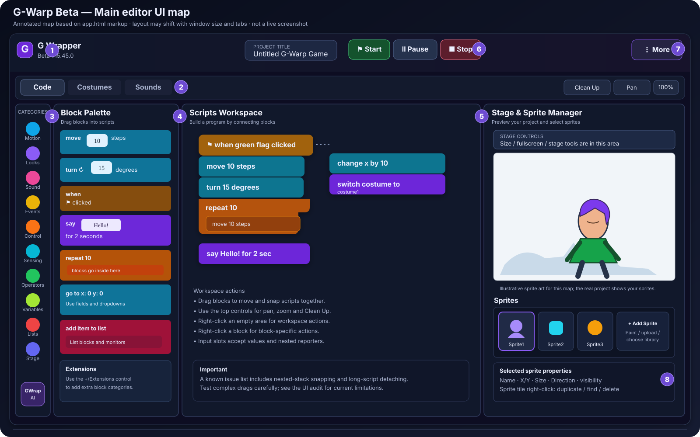
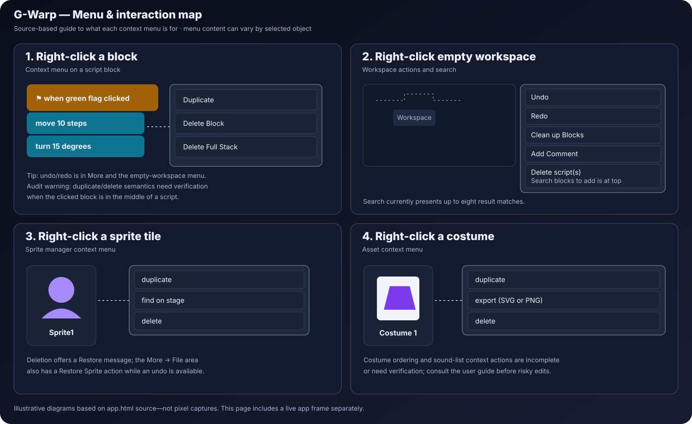

# G-Warp Screenshot and UI Behavior Documentation

**Version inspected:** G-Warp Desktop Beta v15.45.0  
**Source:** [app.html](https://github.com/Creapter1/gwarp/blob/main/app.html)  
**Live app:** https://creapter1.github.io/gwarp/  
**Audit companion:** [UI-AUDIT.txt](./UI-AUDIT.txt)  
**User guide:** [USER-GUIDE.txt](./USER-GUIDE.txt)

**Screenshot status:** The diagrams below are schematics, not actual captured screenshots. The live app could not be opened in the available browser environment. Do not treat these illustrations as browser verification.

## 1. Main UI map

| Area | Purpose | Main interaction |
|---|---|---|
| Project/menu controls | New/open/save/export/restore and tools/settings | Select a menu item and follow its dialog/download |
| Category rail | Block families and Extensions | Choose a category; single-click navigation is a known audit item |
| Block palette | Find blocks and drag them into scripts | Drag by block body to a valid connection |
| Script workspace | Assemble, arrange, comment, and inspect scripts | Drag, snap, pan/zoom, right-click |
| Stage | Preview project behavior | Green Flag, Stop, G-Warp Pause, stage-size controls |
| Sprite list | Select and manage sprites | Click a tile; right-click for available actions |
| Main tabs | Code, Costumes, Sounds | Click a tab; verify the active sprite first |
| Asset tools | Draw, upload, edit and audition media | Select an asset, edit/test, then save/apply |

## 2. Common interaction flow

## 3. Main editor: how controls work

### Project controls and More menu
File/edit/tools/settings actions are grouped in the menu system. Prefer the explicit Save action until Ctrl/Cmd+S is verified: the inspected source contains overlapping global save handlers.

### Category rail and palette
The rail represents block categories and Extensions. A Scratch-like category should respond to one click. The inspected source has a double-click filtering path, while single-click does not reliably select/scroll to the category. If a click appears to do nothing, use the palette's existing filter/search controls or right-click empty workspace for block search.

### Workspace
Drag palette blocks into the workspace. Statement blocks connect vertically, C-blocks contain nested sequences, and reporter/Boolean blocks fit matching inputs. Right-click a block for block actions; right-click empty workspace for workspace actions. The audit flags long-stack detachment and nested snapping risks, so test small scripts before rearranging long stacks.

### Stage and run controls
Green Flag starts Green Flag scripts. Stop ends execution. Pause is an extra G-Warp control, but the inspected handler may not pause active audio. The stage click handler also needs browser verification because the source audit found a possible issue with sprite-specific click scripts.

### Sprite list
Click a tile to select the sprite that owns the Code/Costumes/Sounds context. Available tile actions include duplicate, find on Stage, and delete. An Export Sprite action was not found in the inspected menu. The inspected source did not reveal editor-mode drag-to-reposition on the Stage.

### Code, Costumes, Sounds
Code is for scripts, Costumes for the selected sprite's visuals, and Sounds for audio assets/music tools. Confirm the active sprite and asset before editing. Switch away and back to check persistence, then save/reload a copy.

### Costumes
The costume list supports click/keyboard selection. Paint new, Upload, and duplicate/export/delete operations are available in the inspected UI. Drawing controls depend on vector/bitmap mode. Costume list drag-reordering was not found in the inspected source.

### Sounds and instruments
Sound rows support selection; Upload and Record controls are present. Recording requires microphone permission. Instrument Playground provides instrument groups and shaping controls. Sound-row right-click and drag-reordering handlers were not found in the inspected source.

### Variables, comments, monitors
Use the Variables/data category for variables and lists. Empty-workspace right-click includes Add Comment, but the inspected comment system creates workspace comments rather than fully block-attached Scratch comments. Monitor dragging and monitor-specific context menus appear incomplete.

### Extensions and advanced tools
Extensions are accessible from the category rail. Source-present tools include GWrap AI/search/debugging, tilemap, Behavior Designer, LAN collaboration, project health/restore, and advanced settings. Availability may depend on build, developer mode, or browser capabilities.

## 4. Context-menu reference

| Target | Behavior found in source | Notes |
|---|---|---|
| Block | Duplicate, Delete Block, Delete Full Stack | Selected-block versus whole-stack semantics need verification |
| Empty workspace | Undo, Redo, Clean up Blocks, Add Comment, Delete Blocks, block search | Search shows at most eight matches |
| Sprite tile | Duplicate, find on Stage, delete | Export Sprite not found |
| Costume row | Duplicate, export, delete | Context actions exist |
| Sound row | No matching sound context handler found | Use visible controls |
| Variable/list monitor | No monitor-specific context menu found | Use visibility controls |

## 5. Tabs and asset selection
1. Select the intended sprite.
2. Choose Code, Costumes, or Sounds.
3. Confirm the sprite/asset name.
4. Make a small change.
5. Switch away and back to check it persists.
6. Save/export and reload a copy to verify.

The source calls a costume-loading routine on every main-tab change. This is a risk to test with unsaved drawing work, not a claim that data loss was reproduced.

## 6. Pointer and keyboard notes
- Use visible menu actions if a shortcut has uncertain behavior.
- Ctrl/Cmd+S is a high-priority verification item.
- Right-click blocks and empty workspace separately; their menus differ.
- Drag from the block body, not from an input field.
- In Pan mode, start on empty workspace until the possible pan/drag conflict is verified.
- Context menus may need viewport-edge and keyboard focus improvements.
- Some shortcuts documented by TurboWarp/PenguinMod are addon-dependent and are not necessarily Scratch-core behavior.

## 7. Capture real screenshots
To replace the schematics with actual screenshots on a desktop browser:
1. Open the live app and maximize the browser.
2. Capture the default Code view with Stage, sprite list, category rail, and workspace visible.
3. Capture the More menu.
4. Capture right-click on a block.
5. Capture right-click on empty workspace.
6. Capture Costumes with a sprite selected.
7. Capture Sounds and instrument/music controls.
8. Capture Extensions and any advanced tool you plan to document.
9. Save images in `chatgpt/images/` with descriptive filenames.
10. Record browser version and app commit. Replace the schematic images and label the source build. Do not mark an interaction browser-verified without testing it.

## 8. Verification note
This is based on static inspection of the checked-in app.html identified as Beta v15.45.0, not a live browser test. For priorities, proposed fixes, and the complete regression plan, see [UI-AUDIT.txt](./UI-AUDIT.txt).
