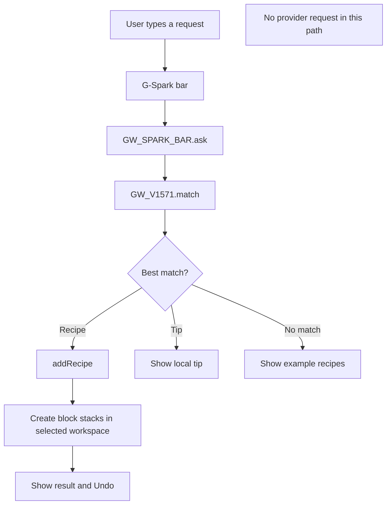
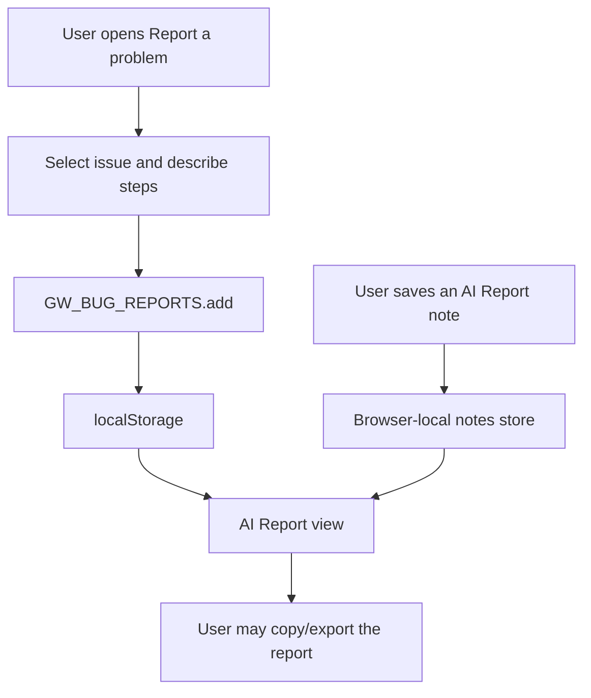
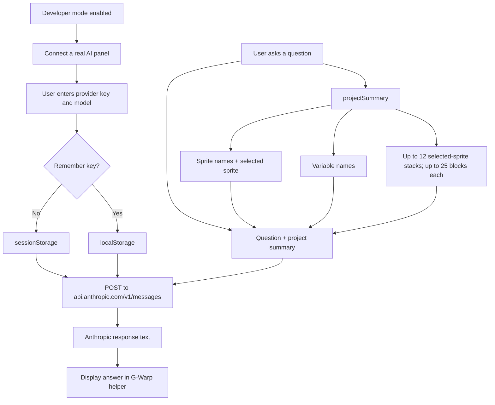

# G-Warp AI Data Flow — Source-Verified Map

**Source inspected:** checked-in ai-team/app.html blob SHA 16b7942c0caa6cf9e20ed9067e53a6e486588fbe, stamped Beta v15.60.0.  
**Review date:** 2026-11-02.  
**Evidence:** SOURCE-VERIFIED. This document describes code paths found in the source; it is not a live network capture or a credential test.

This page exists to prevent three different features from being described as though they were the same AI system.

## 1. G-Spark quick helper: local recipe and tip lookup

The source module gw-v1555-gspark-bar calls the local matching API. The match is drawn from built-in recipe and tip records defined in gw-v1571-blocks and supplemented by embedded JSON installed through gw-v4900-gwrap-pack and gw-v4960-chatgpt-gwrap-pack. The pack loader converts recipe descriptions into G-Warp blocks using the local builders, then adds the entries to GW_V1571. A matching recipe adds blocks to the currently selected sprite's workspace. The helper then shows the selected recipe name and offers Undo.

The separate root research/ folder is not automatically loaded by the checked-in app source. Its game-design notes are a research library for humans, AIs and recipe authors. To affect the running helper, a note must be translated into an embedded recipe/tip pack and integrated, or a future source-verified research loader must be built.

**What this proves:** the checked-in G-Spark bar has an offline recipe/tip and block-building path.  
**What this does not prove:** that a generative model, Ollama, Anthropic or another external provider was connected.

## 2. Bug questionnaire and AI Report: browser-local storage

The checked-in gw-v1580-aihelp module stores bug report entries under the browser storage key gwarp-bug-reports. AI Report notes are stored in the browser as well. Saving a bug report is not itself a network request.

## 3. Developer-only real-AI route: Anthropic Messages API

### Exact source behavior

The developer-only path in gw-v1580-aihelp:

- Reads the key from sessionStorage first, then localStorage.
- Uses a model string stored in localStorage; source default is claude-sonnet-5-5.
- Builds project summary text from all non-clone sprite names, the selected sprite name, variable names and a limited text summary of the selected sprite's top-level scripts.
- Inspects at most 12 top-level script stacks for the selected sprite. For each inspected stack, it reads up to 25 child blocks and truncates each block's text to 60 characters.
- Sends the user question plus that project summary in the user message, with a system prompt, a maximum of 700 output tokens and the configured model.
- Makes a direct browser request to https://api.anthropic.com/v1/messages using the x-api-key header and Anthropic version header.
- Displays returned text in the helper.

This is a direct browser-to-provider path using the user's own key. It may incur provider charges and is subject to provider terms. The source's explanatory text says the key stays in this browser and is sent to the AI service. Never put a real key into screenshots, examples, test fixtures or repository content.

### What is included and what is not

The source function includes sprite names, the selected sprite, variable names and script text snippets. The inspected function does not append costume images, sound binaries or an entire SB3 file to that project summary. Do not claim more context is transmitted unless a later source module changes this function or another request path is found.

## 4. Local-model / Ollama path: not established by this source blob

The checked-in app.html blob inspected for this diagram contains no verified implementation of:

- an Ollama connector;
- a llama-server connector;
- an LM Studio connector;
- a localhost:11434 request;
- a /models command or model-discovery route;
- in-browser WebGPU model inference;
- an in-app local-model downloader.

The November 2 local screenshot shows a “0 models found” response from a /models prompt. Claude's report says the capture used local snapshot 2026-11-02_1010_ideas-plus-tab, but does not include the exact source commit. That result cannot be attached to the checked-in source path above until the capture source is supplied and inspected.

Installing Ollama on a computer does not, by itself, mean G-Warp can call it. A real connector would need an explicit endpoint/configuration path, request code, response parsing, error handling, privacy notice and browser/network compatibility checks.

## 5. Live evidence still needed

Source inspection does not replace a controlled browser test. The next verification should:

1. Run the exact checked-in source build with a harmless demo sprite and no real API key.
2. Open G-Spark and confirm a known recipe can be added and undone while network requests are monitored.
3. Submit a dummy bug report and confirm it is stored locally without an outbound request.
4. Do not send a real Anthropic key. Test the developer panel with a mock/stubbed fetch or a disposable test environment that cannot incur charges.
5. Capture the request payload shape with all keys and personal project names removed.
6. If a local-model connector exists in a later build, provide its exact source commit and separately test a harmless prompt against a local mock endpoint.

Until that test is run, this document remains **SOURCE-VERIFIED / NOT LIVE-TESTED**.
