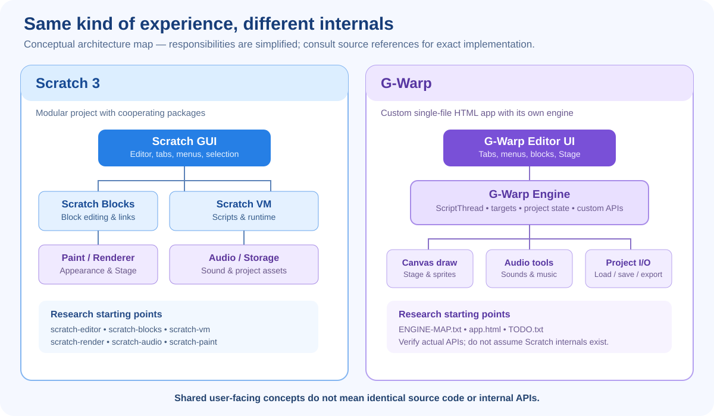

# G-Warp and Scratch-Style Editors — Deep Engineering Reference

**Purpose:** a source-grounded research reference for understanding how G-Warp works, how Scratch 3 works conceptually, where they align, and what evidence is needed to reproduce compatible behavior. This is not the beginner guide; start with [Learn G-Warp](./LEARNING-GUIDE.md) first.

**G-Warp source inspected:** `app.html`, Beta v15.45.0, source SHA `7ce527ca2908c63bbdfe642856ca29fd82178648` as recorded by the audit/engine map.  
**G-Warp architecture reference:** [ENGINE-MAP.txt](../ENGINE-MAP.txt)  
**UI behavior evidence:** [LIVE-UI-VERIFICATION.txt](./LIVE-UI-VERIFICATION.txt) and [UI-AUDIT.txt](../chatgpt/UI-AUDIT.txt)

## 1. Executive model

[Open the architecture comparison SVG](./images/gwarp-scratch-architecture.svg)

A Scratch-like editor has several cooperating systems:

1. **Editor UI:** project controls, tabs, sprite selection, categories, palette, workspace, Stage and asset editors.
2. **Block representation:** block types, fields, inputs, connections, top-level scripts, and coordinates.
3. **Runtime:** events start script threads; threads advance through blocks; control blocks, waits, broadcasts, clones, variables and procedures affect execution.
4. **Target/project state:** sprites, clones, Stage/backdrops, costumes, sounds, variables/lists, extensions and project metadata.
5. **Rendering and input:** draw the Stage and costumes; route mouse, keyboard and Stage events to the correct target.
6. **Audio:** load, synthesize, schedule, stop and manage sound assets.
7. **Persistence/interchange:** serialize project state, package assets, import files, and export a compatible project.
8. **Safety and performance:** extension permissions, clone/list limits, runaway scripts, stop/cleanup behavior and recovery.
9. **Verification:** tests for exact semantics and interaction parity, not just screenshots.

The key research rule: similar UI does not imply the same internal implementation. G-Warp is not Scratch VM. Its internals must be understood from G-Warp source and its engine map, while Scratch's semantics should be researched from Scratch's own code/specification.

## 2. Scratch 3 architecture: authoritative starting points

Scratch's own repository documentation describes a modular architecture: the GUI is the React-based front end; the VM manages project state and business logic; Scratch Blocks handles block UI/logic; the renderer handles the Stage; audio and storage are separate systems. See the [Scratch GUI getting-started architecture note](https://github.com/scratchfoundation/scratch-gui/wiki/Getting-Started) and the [current scratch-editor monorepo GUI package](https://github.com/scratchfoundation/scratch-editor/tree/develop/packages/scratch-gui).

Useful primary references:
- [Scratch editor UI package](https://github.com/scratchfoundation/scratch-editor/tree/develop/packages/scratch-gui) — tabs, layout, menus, editor state, loading state.
- [Scratch VM package](https://github.com/scratchfoundation/scratch-editor/tree/develop/packages/scratch-vm) — project runtime and execution semantics.
- [Scratch Blocks](https://github.com/scratchfoundation/scratch-blocks) — visual block representation and connections.
- [Scratch Render](https://github.com/scratchfoundation/scratch-render) — Stage rendering.
- [Scratch Audio](https://github.com/scratchfoundation/scratch-audio) — audio behavior.
- [Scratch Storage](https://github.com/scratchfoundation/scratch-storage) — assets/project loading and storage.
- [Scratch Paint](https://github.com/scratchfoundation/scratch-paint) — costume editing.
- [Scratch Specification](https://scratchspec.github.io/) — independent, explicitly work-in-progress description of runtime, palette, file format and I/O. Use as a guide, then verify against source.
- [Scratch VM README](https://github.com/scratchfoundation/scratch-vm) — explains the VM and block-to-AST relationship.

**Repository status note:** older standalone Scratch repositories have been migrated/archived in favor of the `scratch-editor` monorepo. For current implementation research, prefer the monorepo package paths while retaining older READMEs as explanatory references.

## 3. G-Warp architecture: confirmed from its own engine map

G-Warp is a single-file HTML application with a custom engine. Do not write patches against Scratch internals and expect them to work.

### Runtime and project state
The G-Warp engine map identifies `window.Engine` as the main object. Its documented fields include:
- `sprites`, `activeSpriteIndex`
- `threads` (ScriptThread objects)
- `variables`, `lists`, visibility state for monitors
- `backdrops`, `activeBackdrop`
- `isRunning`, `isPaused`, `isTurbo`, `cloneLimit`
- frame timing, mouse and keyboard state, answer/audio context
- broadcasts, extensions, tilemap, behavior system

The map names the script execution type `ScriptThread`, with fields including `sprite`, `blocks`, `pc`, `callStack`, `waitUntil`, and `finished`. A thread's `blocks` is the whole script, not an empty stack. The main loop walks `Engine.threads` and calls `step()`.

### Rendering
G-Warp draws with its own 2D canvas code. Do not assume it has Scratch's WebGL renderer or a public `Engine.renderer`. The engine map explicitly says there is no `Engine.renderer`, no WebGL drawables, and no Scratch-style `isTouchingDrawables` hook.

### Costumes
The map identifies:
- `window.GW_V15_COSTUME_EDITOR` with save/load/mode/list helpers
- `window.GW_VECTOR_EDITOR` with vector-mode helpers
- Costume data fields including `name`, `canvas`, `res`, rotation center `rc`, `dataFormat`, and optional SVG
- `sprite.costumes` and `sprite.activeCostume`

The editor has vector and bitmap modes. Do not guess editor state property names: the map says `costumeMode`, `svgTool`, `bitmapTool`, `selectedSvg`, etc. are real fields and warns that assumed fields such as `state.mode` or `fillColor` are not real.

### Helpers and integration
The engine map lists `window.GW`, `window.GW8`, `GW_DIALOG`, `GW_CONFIRM`, `GW_ASK`, `GW_FEATURE_OFF`, `GW_WARP_GUARD`, `GW_SETTINGS`, `GW_BUILD`, `GW_EXT_DANGER`, and `GW_SCRATCH_LOOK`. Treat this as the known API list, not proof every function is public or stable. Verify current source before using a name.

**Required integration rule:** if a hook is not in the engine map or cannot be verified in the current source, document it as unknown and ask the maintainer to expose a hook. Never invent a Scratch-style API.

## 4. Mapping the editor UI to the underlying systems

| User-visible area | User action | System responsibilities | Research/test question |
|---|---|---|---|
| Category rail / palette | click category, search, drag block | category selection, palette filtering, block definitions | Does one click navigate? Are all categories and extensions reachable? |
| Workspace | drag, snap, detach, delete, duplicate, comment | block graph, geometry, zoom/scroll transform, undo/redo | Does the graph remain valid at nested levels and after undo? |
| Code tab | select/edit scripts | selected target + block workspace | Does tab/sprite switching preserve edits and target identity? |
| Stage | start, stop, pause, click sprite, drag sprite | runtime state, input routing, drawing, effects, audio | Are events routed to the correct target and are all effects stopped/reset? |
| Sprite list | select, duplicate, delete, reorder | target collection and active target | Does selection remain correct after clone/delete/import? |
| Costumes | paint, select, resize, rotate, reorder | costume state, vector/bitmap tools, rotation center, history | Do edits persist across tab switch and file round-trip? |
| Sounds/music | upload, record, synthesize, audition | audio context, sound assets, playback lifecycle | Does Stop/Pause stop the intended audio? Are assets saved? |
| Variables/lists | create, mutate, show/hide monitor | scope, storage, monitor UI | Are scoping, index, numeric and text rules Scratch-compatible? |
| More/file menu | new/open/save/export/restore | project lifecycle, serialization, asset packaging | Does save/reopen preserve project state exactly? |
| Extensions | add extension, use its blocks | block registration, runtime functions, permissions | Are origin, risk labels, export compatibility and cleanup correct? |

## 5. Runtime semantics to study for compatibility

A similar editor must match observable behavior, not just block names:
- Event hats and when/how scripts start.
- Thread scheduling, waits, loops, stop behavior, and restart behavior.
- Broadcast ordering and whether receivers run immediately or later.
- Clone creation, initialization, deletion, limits, and clone-specific scripts.
- Variable and list scope, indexing, coercion, rounding and comparison rules.
- Reporter/Boolean evaluation, empty values, text/number conversion, and edge cases.
- Procedure definitions, parameters, recursion/warp behavior if supported.
- Sprite direction, rotation styles, movement, edge bounce, layer order, visibility and graphic effects.
- Mouse/keyboard sensing, sprite hit testing, touching, timer, answer and stage click events.
- Pen/tilemap/custom extension behavior, if those extensions are part of the target.
- Sound scheduling, effects, stop-all-sounds, and pause semantics.
- Serialization of targets, block connections, asset references, variables, lists, extension metadata and stage/backdrop state.

Do not declare parity from a handful of example projects. Build a test matrix with small projects and exact expected values/outcomes, then compare Scratch and G-Warp.

## 6. Block graph and snapping model

A block workspace is a graph/tree-like structure, not just coloured rectangles. At minimum, a representation must distinguish:
- block identity and opcode/type
- field values
- input sockets and their child connections
- next-statement connection
- parent/child relationship
- top-level script roots
- shadow/default input blocks where applicable
- workspace coordinates and selection/drag state
- C-block body and else branch
- block shape/connection compatibility
- undo/redo state

The Scratch VM README includes an example block object with `opcode`, `inputs`, `fields`, `next`, `topLevel`, `parent`, `shadow`, `x`, and `y`. Treat that as a useful conceptual example, not a claim G-Warp stores blocks in exactly that format.

For G-Warp, test: dragging from the middle of a long stack; dragging a nested stack out of a C-block; inserting at each nested level; cap/hat constraints; zoom/scroll offsets; pointer release outside the workspace; undo/redo after every graph mutation. The live verification report has not yet tested nested/long-stack cases.

## 7. Project format and interchange

G-Warp's engine map says its current loader opens SB3 and ZIP-type PMP files through the local-file menu, plus JSON and ZIP, and has a PenguinMod-link path. It states that newer protobuf-based PMP files are missing. Treat this as source documentation from the inspected version, not a guarantee for every future build.

For reliable interchange tests:
1. Create a small project containing multiple sprites, a backdrop, costumes, sounds, variables/lists, nested control blocks, broadcasts, and a clone.
2. Save/export.
3. Open it in a fresh G-Warp session.
4. Open the same supported file in Scratch/TurboWarp/PenguinMod where applicable.
5. Compare scripts, target order, variables, assets, sounds, and runtime output.
6. Record unsupported extensions/features instead of silently dropping them.

A round-trip test is not complete until both import and export are tested. The current live report says SB3 export/import round-trip remains NOT TESTED.

## 8. Testing and evidence discipline

Use these labels consistently:
- **SOURCE-VERIFIED:** directly located in the current source.
- **STATIC-ANALYSIS:** a likely consequence of source structure, not reproduced in a browser.
- **LIVE-BROWSER-VERIFIED:** tested in a named browser, viewport, and build with recorded steps.
- **NOT TESTED:** no result claimed.
- **FAILED:** the stated expected behavior was tested and did not occur.

Every reported defect should include: test ID, build/version or source SHA, browser/viewport, setup, exact steps, expected result, actual result, pass/fail, screenshot/video/log, and whether a regression test exists.

Current evidence snapshot: Claude's 2026-10-13 Chromium run passed ten basic UI/layout checks at 1440×900 and 1024×700. This does not verify deep runtime parity. See [LIVE-UI-VERIFICATION.txt](./LIVE-UI-VERIFICATION.txt).

## 9. Security, performance, and recovery

A block editor executes user-created programs, so runtime correctness includes containment:
- Bound clone creation, list size, string growth and expensive loops.
- Yield to the browser so Stop and recovery controls remain responsive.
- Stop must clean up threads, clones, timers, sounds and effects.
- Pause must define what happens to scripts and audio separately.
- Extension permissions and dangerous capabilities must be visible and explicit.
- Avoid sending project/user data anywhere without clear consent.
- Large projects need robust persistence and recovery; browser localStorage may be too small for project-scale assets.
- Stress tests should cover Stop during loops, clones inside clones, rapidly triggered hats, large lists, long strings, many sounds, and import failures.

G-Warp's TODO has an active freeze-safety task. The engineering reference should be read alongside the current TODO, merge queue, and engine map before writing or integrating a patch.

## 10. Research workflow for an unfamiliar subsystem

1. Read `AI-TEAM.txt`, `TODO.txt`, `ENGINE-MAP.txt`, and `MERGE-QUEUE.txt`.
2. Identify the user-visible behavior and the exact Scratch baseline.
3. Locate the current G-Warp source implementation and its real functions/state.
4. Trace the full path: UI event → state mutation → runtime/asset operation → rendering/persistence.
5. Write a minimal reproduction and expected behavior before proposing a fix.
6. Compare against official Scratch sources/specification and TurboWarp/PenguinMod documentation where relevant.
7. Separate observed facts from assumptions.
8. Propose one small, reversible module with a feature-off switch and matching NOTES file, following repository rules.
9. Test normal, edge, undo/redo, save/reload, and performance cases.
10. Let Claude review/merge; owner approval is required before shipping.

This process is a research discipline, not a promise that all behavior is already replicated. A faithful Scratch-like environment requires systematic compatibility testing over time.

## 11. Source and reference library

### G-Warp
- [Application source](../app.html)
- [Engine map](../ENGINE-MAP.txt)
- [TODO / active roadmap](../TODO.txt)
- [AI team rules and log](../AI-TEAM.txt)
- [Merge queue](../MERGE-QUEUE.txt)
- [UI audit](../chatgpt/UI-AUDIT.txt)
- [Live browser report](./LIVE-UI-VERIFICATION.txt)
- [UI guide and screenshot gallery](../chatgpt/SCREENSHOT-UI-DOCUMENTATION.md)

### Scratch
- [Scratch editor monorepo](https://github.com/scratchfoundation/scratch-editor)
- [Scratch GUI package](https://github.com/scratchfoundation/scratch-editor/tree/develop/packages/scratch-gui)
- [Scratch VM package](https://github.com/scratchfoundation/scratch-editor/tree/develop/packages/scratch-vm)
- [Scratch Blocks repository](https://github.com/scratchfoundation/scratch-blocks)
- [Scratch Render repository](https://github.com/scratchfoundation/scratch-render)
- [Scratch Audio repository](https://github.com/scratchfoundation/scratch-audio)
- [Scratch Storage repository](https://github.com/scratchfoundation/scratch-storage)
- [Scratch Paint repository](https://github.com/scratchfoundation/scratch-paint)
- [Scratch Specification (work in progress)](https://scratchspec.github.io/)
- [Scratch GUI architecture overview](https://github.com/scratchfoundation/scratch-gui/wiki/Getting-Started)

### TurboWarp and PenguinMod
- [TurboWarp editor](https://turbowarp.org/editor)
- [TurboWarp addons](https://turbowarp.org/addons)
- [PenguinMod Code Editor documentation](https://docs.penguinmod.com/codeeditor/)
- [PenguinMod shortcuts](https://docs.penguinmod.com/shortcuts/)

Use official source as the first authority for Scratch behavior. Use community documentation and independent specifications to discover edge cases, then verify them against implementation and reproducible tests.
