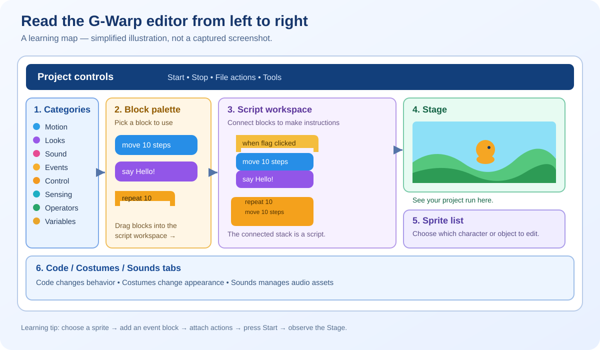
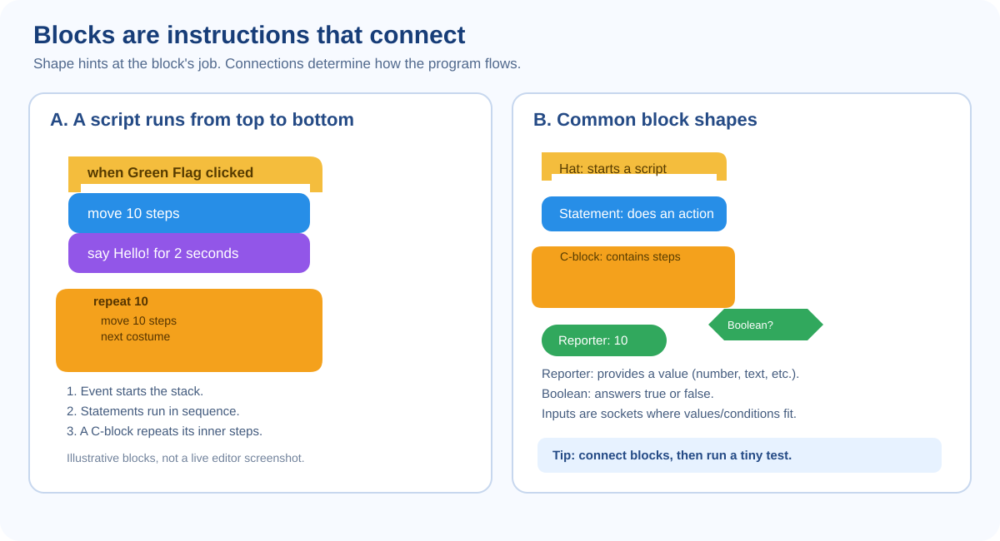

# Learn G-Warp: A Friendly Guide to How Scratch-Style Coding Works

**Audience:** someone opening G-Warp for the first time  
**Goal:** learn the ideas behind G-Warp and Scratch by doing, not by reading a wall of technical words  
**App version covered:** Beta v15.45.0, unless the live app says otherwise

Start with this guide. For a complete control-by-control reference, continue to [the UI guide](../chatgpt/SCREENSHOT-UI-DOCUMENTATION.md). For deep technical research, use [the engineering reference](./ENGINEERING-REFERENCE.md).

## The big idea

G-Warp and Scratch use the same friendly idea: instead of typing every line of code, you connect puzzle-shaped blocks. The connected blocks describe instructions. When you press Start/Green Flag, the engine follows those instructions and changes what happens on the Stage.

A project is not just the picture you see. It contains:
- **Sprites:** characters or objects that can move and run code.
- **Stage and backdrop:** the scene behind the sprites.
- **Scripts:** connected blocks that tell a sprite or the Stage what to do.
- **Costumes:** a sprite's different looks or animation frames.
- **Sounds:** audio assets a project can play.
- **Data:** variables and lists that remember information.
- **Events:** signals that start scripts, such as the Green Flag, a key press, or a message.
- **Project data:** the information saved to a project file.

## 1. Learn the screen in one minute

[Open the editor map SVG](./images/gwarp-editor-map.svg)

- **Category rail:** choose a family of blocks, such as Motion, Looks, Sound, Events, Control, Sensing, Operators, Variables, or Extensions.
- **Block palette:** the blocks available in the chosen family.
- **Script workspace:** the place where you connect blocks into programs.
- **Stage:** the running scene where you see the result.
- **Sprite list:** choose which character or object you are editing.
- **Code / Costumes / Sounds:** switch between a sprite's behavior and its media.
- **Top controls:** start, pause, stop, and access project/file/tool actions.

G-Warp keeps its own dark visual style, electric C-blocks, G-Spark mascot, and extra tools. Scratch is the behavior reference, not a requirement to copy Scratch's appearance.

## 2. Your first working program

Try this in a new or disposable project:

1. Select a sprite in the sprite list.
2. Open **Code**.
3. Click **Events** in the category rail.
4. Drag the **when Green Flag clicked** hat block into the workspace.
5. Open **Motion** and drag **move 10 steps** beneath the hat until the blocks connect.
6. Open **Looks** and attach a **say** block beneath the move block if one is available.
7. Press **Start / Green Flag**.
8. Watch the Stage. Press **Stop**, change the number, and try again.

What happened? The event block waited for a signal. When you started the project, it launched the connected sequence. The Motion block changed the sprite's position. The next block ran after it.

If the block does not connect, move the pointer slowly over the top/bottom connection until the snap preview appears. Drop only when the intended connection is highlighted. Basic block dragging passed a live browser check; complex nested stacks still need additional testing.

## 3. Understand block shapes

[Open the block shapes SVG](./images/gwarp-blocks-explained.svg)

| Shape | What it means | Typical use |
|---|---|---|
| Hat (rounded top) | Starts a script; it listens for an event | Green Flag, key pressed, message received |
| Statement (stack-shaped) | Performs an action and connects to other statements | Move, say, change variable |
| C-shaped block | Holds other blocks inside it | Repeat, forever, if |
| Rounded reporter | Produces a value | Position, answer, variable, arithmetic result |
| Hexagonal Boolean | Produces true/false | Touching?, key pressed?, comparisons |
| Cap (rounded bottom) | Ends a statement stack | Stop-related/control endings |

Think of a script as a recipe. The hat says when to begin. The blocks below say what to do. A C-block is a recipe step that contains a smaller recipe.

## 4. Events, order, and repetition

**Events** start a script. A sprite can have multiple scripts that respond to different events. A broadcast/message can tell other scripts to start.

**Order matters.** In a stack, the next connected statement normally runs after the previous one completes. Some blocks wait, loop, or start other scripts.

**Repeat** runs the enclosed sequence a set number of times. **Forever** keeps repeating until the script is stopped or the runtime ends it. Loops that never wait or do useful yielding can make a project unresponsive, so test small first.

**If** runs its inner blocks only when its Boolean condition is true. **If/else** chooses one of two paths.

## 5. Variables and lists: remembering things

A **variable** stores one value, such as score, lives, or speed. A **list** stores a sequence of values, such as inventory items or quiz questions.

Try creating a score variable:
1. Open Variables/data.
2. Create a variable and choose its scope if prompted.
3. Use a set block to start it at zero.
4. Use a change block when a point is earned.
5. Show its monitor on the Stage if available.

A variable's scope matters: a value for one sprite is different from a value shared by all sprites. Check the variable's scope when another sprite cannot see the value you expected.

## 6. Sprites, Stage, costumes, and animation

A **sprite** is a project object with its own code and assets. Selecting a sprite changes which scripts, costumes, and sounds you edit. The **Stage** is the scene; its backdrop is not a regular sprite.

A **costume** changes how a sprite looks. To make a simple animation, create or import several costumes and switch between them using Looks blocks. Costume list drag-reordering was not verified in the current live test, so do not depend on it without checking.

The **rotation center** affects how a costume rotates. Costume mode and drawing tools may differ between vector and bitmap editing. Duplicate a costume before making destructive edits.

## 7. Sounds and music

A sound is an asset that a sprite or the Stage can play. You can use the Sounds tab to select, upload, or record assets where available. Browser microphone permission may be needed for recording.

G-Warp also includes music/instrument tools beyond the basic Scratch workflow. The current live UI check confirmed the Sounds tab opens, but it did not validate every instrument, effect, recording, or music-export path. Treat advanced music tools as a separate feature set and test the save result.

## 8. Test your project like a maker

After each change:
1. Stop the project.
2. Make one small edit.
3. Start it again.
4. Check the Stage and any variable monitors.
5. If the result is wrong, undo the last edit and test a smaller script.
6. Save a checkpoint before larger edits.

A good bug report says: what you clicked, what you expected, what actually happened, the app version/browser, and whether it happens in a small new project.

## 9. Save, load, and share

Use the explicit project/file menu actions to save, load, or export. A project file may contain code and media, not just the visible Stage. After importing a project, check its sprites, scripts, variables, costumes, sounds, and any extensions.

G-Warp supports several import paths according to its current source/UI, but the latest live verification did **not** test an SB3 export-and-reimport round trip. For important work, keep a backup and verify the exported file in a fresh load.

## 10. How Scratch and G-Warp relate

The everyday mental model is deliberately similar: select a sprite, choose blocks, connect a script, run it, inspect the Stage, edit assets, and save the project.

They are **not the same codebase**. Scratch 3 is built from cooperating parts including its editor UI, block system, virtual machine/runtime, renderer, audio, paint, and storage components. G-Warp is a single-file HTML app with its own JavaScript engine, custom block UI, canvas renderer, costume editor, audio tools, and project handling. This means a Scratch concept is a useful guide, but a Scratch internal function name cannot be assumed to exist in G-Warp.

For example, G-Warp's engine map says the main runtime object is `window.Engine`; it explicitly warns that `window.vm`, `runtime.sequencer`, and `scratch-render` are not G-Warp APIs. The deeper explanation is in [ENGINE-MAP.txt](../ENGINE-MAP.txt) and [ENGINEERING-REFERENCE.md](./ENGINEERING-REFERENCE.md).

## 11. What has actually been tested?

Claude's recorded live run tested ten basic interactions in Chromium on 2026-10-13, at 1440×900 and 1024×700. The tested items included category single-click, basic block drag, two context menus, Start/Stop, More menu, sprite context menu, tab switching, Extensions opening, and narrow layout. They passed that run.

That is not proof that every editor operation is perfect. Nested C-block dragging, long-stack detachment, save shortcuts, SB3 round-trip, Pause/audio, Stage click routing, individual paint tools, advanced dialogs, Firefox, and Safari remain listed as not tested. See [LIVE-UI-VERIFICATION.txt](./LIVE-UI-VERIFICATION.txt).

## Continue learning

- [Complete UI reference](../chatgpt/SCREENSHOT-UI-DOCUMENTATION.md)
- [Full user guide and troubleshooting](../chatgpt/USER-GUIDE.txt)
- [UI behavior audit](../chatgpt/UI-AUDIT.txt)
- [G-Warp engine map](../ENGINE-MAP.txt)
- [Deep engineering reference](./ENGINEERING-REFERENCE.md)
