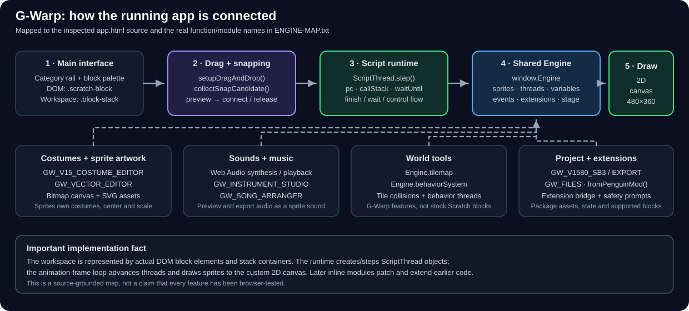
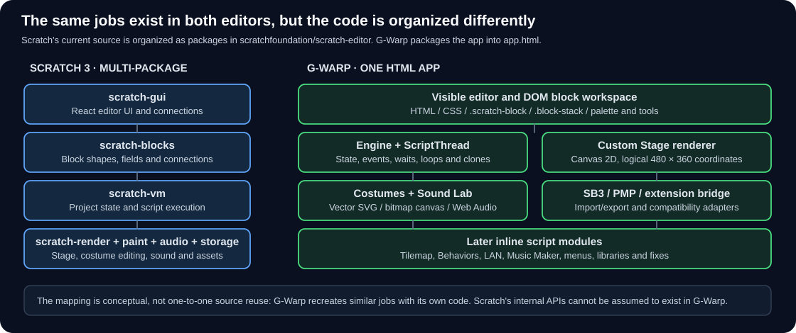

# G-Warp Documentation

This folder explains **the actual G-Warp application**: what you see on screen, how its real code runs, how its tools save their work, and how its implementation relates to Scratch 3. Start with the app map, then follow the guide for the task you are doing.

## 1. The app, explained

**[G-Warp implementation map](./ENGINEERING-REFERENCE.md)** is the main technical guide. It follows the real implementation from block workspace to `ScriptThread`, `Engine`, Stage drawing, costumes, sound/music, Tilemap, Behaviors, extensions and file import/export. It also explains how Scratch itself is organized and maps each Scratch subsystem to the closest G-Warp equivalent.

## 2. How to use the app

- **[Learn G-Warp](./LEARNING-GUIDE.md)** — first project and basic block-coding concepts.
- **[Complete user guide](../chatgpt/USER-GUIDE.txt)** — how to use the existing controls and tools.
- **[Screenshots and UI guide](../chatgpt/SCREENSHOT-UI-DOCUMENTATION.md)** — visual location of the controls, menus, tabs and right-click actions.
- **[Editor-area map](./images/gwarp-editor-map.svg)** and [block shapes](./images/gwarp-blocks-explained.svg) — quick visual explanations.

## 3. What has actually been checked

- **[Live UI verification](./LIVE-UI-VERIFICATION.txt)** — tests actually run in Chromium, with screenshots and the items that remain untested.
- **[UI behavior audit](../chatgpt/UI-AUDIT.txt)** — source-level findings and likely issues. Read it together with the live report.
- **[Real screenshots](./screens/)** — pictures captured from the running app, not drawings.

A test report does not prove every app feature is working. The source map, browser results and untested items are kept separate.

## 4. If you're changing G-Warp

Read [ENGINE-MAP.txt](../ENGINE-MAP.txt) before writing code. It lists the actual engine object and hooks and warns against assuming that Scratch VM internals exist in G-Warp. Then check [TODO.txt](../TODO.txt) and [MERGE-QUEUE.txt](../MERGE-QUEUE.txt) to see the current priority and whether a patch is only a candidate.

## Where Scratch's own code lives

The implementation guide links directly to the official [Scratch editor monorepo](https://github.com/scratchfoundation/scratch-editor) and the actual `scratch-gui`, `scratch-blocks`, `scratch-vm`, renderer, paint and storage components. Use those sources to understand Scratch's implementation; use G-Warp's own `app.html` and [engine map](../ENGINE-MAP.txt) to understand this app.

**Important:** G-Warp is an independent implementation. It aims to provide Scratch-style behavior and project workflows, but it is not Scratch VM and compatibility must be checked feature by feature.
