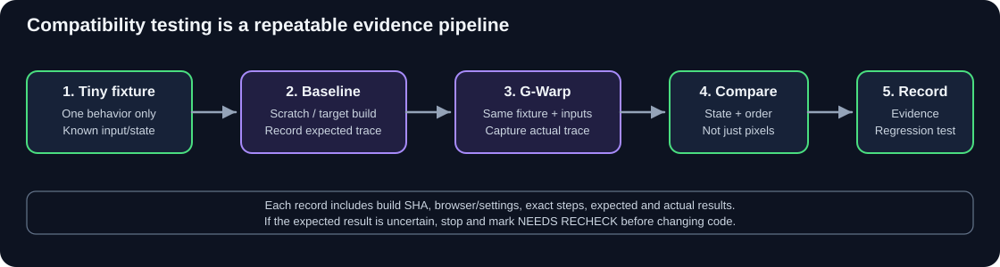
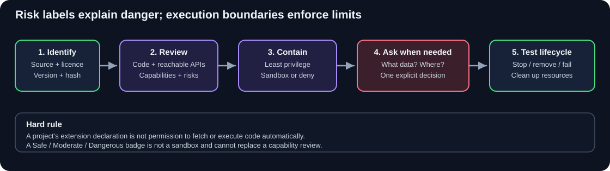

# G-Warp Documentation — Start Here

This is the canonical index. The documentation has **two learning levels**: an easy user-facing path and a deep research path. They describe the same system from different angles.

## Start here: learn to use G-Warp
1. **[Learn G-Warp](./LEARNING-GUIDE.md)** — short, beginner-friendly explanation of the editor and block-coding ideas, with a first project.
2. **[Complete user guide](../chatgpt/USER-GUIDE.txt)** — detailed feature instructions and troubleshooting.
3. **[UI behavior and screenshots](../chatgpt/SCREENSHOT-UI-DOCUMENTATION.md)** — what the controls do, how menus/tabs/dragging/right-click work, and real screenshot evidence.
4. **[Real screenshot gallery](./screens/)** — captures from the running app.
5. **[Live UI verification](./LIVE-UI-VERIFICATION.txt)** — test setup, results, and what is not yet tested.

## Deep research: understand how it works

1. **[Engineering reference](./ENGINEERING-REFERENCE.md)** — subsystem overview and G-Warp/Scratch source mapping.
2. **[Editor engineering playbook](./EDITOR-ENGINEERING-PLAYBOOK.md)** — graph model, block dragging/snapping, runtime scheduler, rendering, history, serialization and safe integration.
3. **[Research library](./RESEARCH-LIBRARY.md)** — annotated source map, upstream references, evidence hierarchy and research workflow.
4. **[Runtime semantics and parity](./RUNTIME-SEMANTICS-AND-PARITY.md)** — scheduling, broadcasts, clones, coercion, sensing, costumes, audio and observable compatibility.
5. **[Compatibility test matrix](./COMPATIBILITY-TEST-MATRIX.md)** — existing test assets, evidence gaps, proposed test IDs and release gates.
6. **[Project formats and round-trip](./PROJECT-FORMATS-AND-ROUNDTRIP.md)** — SB3/PMP boundaries, asset integrity, safe import/export and round-trip checks.
7. **[Extension security model](./EXTENSIONS-SECURITY-MODEL.md)** — threat model, sandbox boundaries, risk labels, privacy and lifecycle testing.
8. **[G-Warp engine map](../ENGINE-MAP.txt)** — recorded real runtime globals/hooks; G-Warp is not Scratch VM.
9. **[UI behavior audit](../chatgpt/UI-AUDIT.txt)** and **[live UI verification](./LIVE-UI-VERIFICATION.txt)** — source findings versus behaviors actually tested.
10. **[TODO roadmap](../TODO.txt)**, **[AI team log/rules](../AI-TEAM.txt)** and **[merge queue](../MERGE-QUEUE.txt)** — current priorities and work status.

Research documents are not product guarantees. Follow the linked primary sources, check version stamps, and keep untested behavior marked NOT TESTED.

## Visual references

### Editor map

### Block coding explained

### G-Warp and Scratch architecture

- [G-Warp editor map (SVG)](./images/gwarp-editor-map.svg) — labeled editor areas and their purpose.
- [Block shapes explainer (SVG)](./images/gwarp-blocks-explained.svg) — event hats, statements, C-blocks, reporters, and Boolean conditions.
- [G-Warp vs. Scratch architecture (SVG)](./images/gwarp-scratch-architecture.svg) — conceptual systems comparison; not an exact code diagram.
- [Main editor schematic](../chatgpt/images/gwarp-ui-map.svg) — explanatory drawing, not a screenshot.
- [Interaction-flow schematic](../chatgpt/images/gwarp-interactions-map.svg) — explanatory drawing, not a screenshot.
- [Real screenshots](./screens/) — actual browser captures; see the live report for which interactions they evidence.

### Research and test diagrams

These are original explanatory diagrams. They describe recommended research/testing workflows, not a claim that every step is already implemented by the app.

## How to read the evidence
- **LIVE-BROWSER-VERIFIED:** a recorded interaction was actually tested in a named environment.
- **SOURCE-VERIFIED:** directly found in a specific source revision.
- **STATIC-ANALYSIS:** source suggests a behavior/risk but it was not reproduced.
- **NOT TESTED:** no result is claimed.
- **SCHEMATIC:** explanatory diagram, not a real app capture.

## Scratch primary references
- [Scratch editor monorepo](https://github.com/scratchfoundation/scratch-editor)
- [Scratch GUI package](https://github.com/scratchfoundation/scratch-editor/tree/develop/packages/scratch-gui)
- [Scratch VM package](https://github.com/scratchfoundation/scratch-editor/tree/develop/packages/scratch-vm)
- [Scratch Blocks](https://github.com/scratchfoundation/scratch-blocks)
- [Scratch Render](https://github.com/scratchfoundation/scratch-render)
- [Scratch Audio](https://github.com/scratchfoundation/scratch-audio)
- [Scratch Storage](https://github.com/scratchfoundation/scratch-storage)
- [Scratch Paint](https://github.com/scratchfoundation/scratch-paint)
- [Scratch Specification (work in progress)](https://scratchspec.github.io/)

**Important:** These SVGs are explanatory diagrams, not screenshots captured from the live app. **G-Warp is a custom engine, not Scratch VM. The two systems aim for similar user-facing behavior, but internal APIs, feature coverage, and edge cases must be verified separately.
