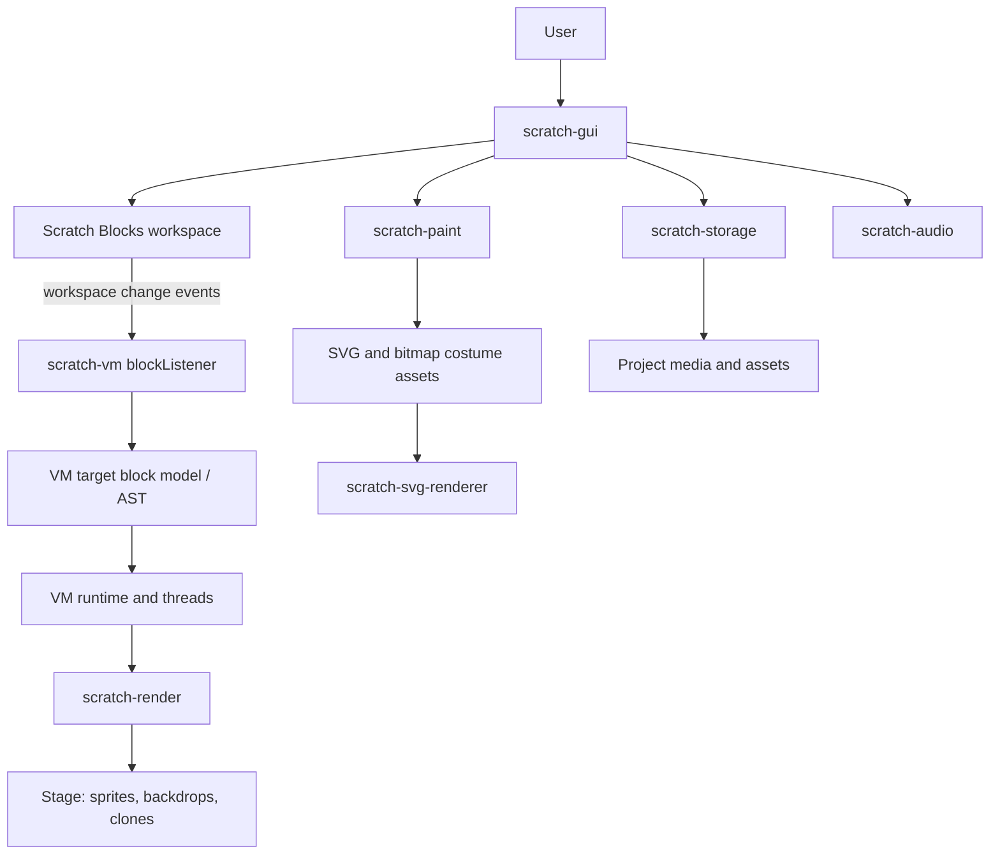

# Upstream Architecture Reference: Scratch, TurboWarp and PenguinMod

This is the companion research map for an AI or developer who needs to understand the original Scratch-style ecosystem before comparing it with G-Warp or designing a new block editor.

**Checked:** 2026-11-02. Upstream projects change; verify each current README, branch and licence before copying commands or code.

## 1. Scratch 3: the systems and how information flows

Scratch is not one giant file or one package. It is a set of cooperating pieces. The current editor development home is the [Scratch editor monorepo](https://github.com/scratchfoundation/scratch-editor), and the team is migrating older repositories into it.

The arrows are a conceptual data-flow map. The exact function names and integration points should be checked in the version being studied.

### Current Scratch editor monorepo packages

The current [scratch-editor README](https://github.com/scratchfoundation/scratch-editor) lists these packages:

| Package | Main responsibility |
|---|---|
| scratch-gui | React buttons, menus, panels, sprite list and integration glue between other systems |
| scratch-vm | represents, runs and maintains Scratch program state |
| scratch-render | draws backdrops, sprites and clones on the Stage |
| scratch-paint | vector (SVG) and bitmap (PNG) artwork for costumes/backdrops |
| scratch-storage | loads assets and wraps fetch behavior for storage/downloads |
| scratch-svg-renderer | processes SVG artwork for use in Scratch |
| scratch-media-lib-scripts | builds/rebuilds editor media libraries |
| task-herder | manages asynchronous task queues and concurrency |

The monorepo README says the package list will grow as more components are migrated. Do not assume every older standalone package has already moved.

### Separate Scratch repositories that still matter

- [Scratch Blocks](https://github.com/scratchfoundation/scratch-blocks) — visual block workspace and connection/UI library. Its 2.0 README says it is no longer a fork of Blockly; it depends on Blockly as a library, uses TypeScript and webpack, and relies on Scratch VM for dynamic programming behavior rather than generating program code itself.
- [Scratch Audio](https://github.com/scratchfoundation/scratch-audio) — Web Audio-based engine for sounds, instruments and effects in Scratch 3.0 projects.

The standalone [scratch-vm](https://github.com/scratchfoundation/scratch-vm) and [scratch-gui](https://github.com/scratchfoundation/scratch-gui) repositories are archived after migration; current development belongs in scratch-editor. The old repository pages remain useful for history, READMEs and links, but an AI should not direct new development there without checking the migration notice.

## 2. Scratch VM: how a block becomes an executable program

The [current scratch-vm README in the monorepo](https://github.com/scratchfoundation/scratch-editor/blob/develop/packages/scratch-vm/README.md) explains the key link:

1. Scratch Blocks emits workspace change events.
2. The VM's blockListener consumes those events.
3. The VM maintains a block/AST model for each target, such as each sprite.
4. The VM starts and runs project threads from that internal representation.

The README's example block record includes the following concepts:

| Field | Meaning |
|---|---|
| id | unique identifier for a block |
| opcode | operation the block represents |
| inputs | nested/reporter/Boolean input connections |
| fields | menu or literal field values |
| next | following statement block |
| topLevel | whether the block starts a top-level script |
| parent | containing block or parent connection |
| shadow | whether it is a shadow/default input block |
| x, y | workspace position for a top-level block |

A target also maintains a list of top-level script IDs. This means the workspace's visual position and the execution graph are related but distinct pieces of state.

A simplified example (illustrative, not a copy of a full Scratch project):

    {
      "id": "block-001",
      "opcode": "event_whenkeypressed",
      "inputs": {},
      "fields": {
        "KEY_OPTION": { "name": "KEY_OPTION", "value": "space" }
      },
      "next": null,
      "topLevel": true,
      "parent": null,
      "shadow": false,
      "x": 120,
      "y": 80
    }

When building a Scratch-like app, this is the important architectural boundary: a block workspace can display and edit a graph, while the VM owns the program's execution state. G-Warp uses a different implementation; see its [source module index](./SOURCE-MODULE-INDEX.md).

Primary reading:
- [Scratch VM README in current monorepo](https://github.com/scratchfoundation/scratch-editor/blob/develop/packages/scratch-vm/README.md)
- [Scratch Blocks README](https://github.com/scratchfoundation/scratch-blocks)
- [Scratch editor package map](https://github.com/scratchfoundation/scratch-editor)

## 3. Scratch GUI: the integration layer

The GUI is more than the block workspace. It coordinates:
- panels, menus, tabs and sprite selection;
- project loading and saving;
- connection between the block workspace and VM;
- asset tools and libraries;
- the Stage view and user-facing overlays;
- extensions/addons and editor-level state.

The current package is under [packages/scratch-gui](https://github.com/scratchfoundation/scratch-editor/tree/develop/packages/scratch-gui). The older standalone [scratch-gui repository](https://github.com/scratchfoundation/scratch-gui) announces its migration and archive status.

For developers, the GUI is usually the first place to understand how the user action is connected to the underlying VM or media package. Follow an actual event handler into the package it calls rather than assuming that a button performs its work itself.

## 4. TurboWarp: Scratch mod plus a different execution strategy

TurboWarp describes itself as a Scratch mod with improved performance and additional features. Its documentation describes a package-based architecture around the GUI, VM, renderer, paint, parser, storage and related systems.

### Interpreter versus compiler

TurboWarp's [How it runs projects](https://docs.turbowarp.org/how) page explains a central difference:

- Scratch runs scripts using an interpreter that walks the program's block/AST representation at runtime.
- TurboWarp can compile scripts to JavaScript functions, so the generated JavaScript performs the script operations.

The [compiler documentation](https://docs.turbowarp.org/new-compiler) describes later compiler work. A compiler can make some workloads substantially faster, but the result depends on the project and the benchmark environment. TurboWarp's published benchmark is not a universal promise for every project or computer.

**Tradeoff to understand:** compilation can make editing a running script less convenient because the executing code has already been generated. Compiler correctness, extension compatibility, timing semantics and debugging all become their own engineering concerns.

### TurboWarp source and addon map

- [TurboWarp GitHub organization](https://github.com/TurboWarp) — inspect the current source repositories.
- [TurboWarp modding guide](https://docs.turbowarp.org/development/getting-started) — describes the development packages and a typical clone/install/start/build flow. The page currently warns that it is outdated, so check each package README before following the commands.
- [TurboWarp addons source](https://github.com/TurboWarp/addons) — this repository describes itself as an internal development location for addon patches, not a general standalone extension project. Its README tells people who are forking TurboWarp to work in scratch-gui's addons directory rather than forking this internal patch repository.

The modding guide currently lists Node.js v22 as the recommended dependency version and uses npm ci as an install pattern, but it explicitly warns that the instructions need updating. Treat them as a starting point, not guaranteed commands for every current checkout.

## 5. PenguinMod: a TurboWarp-derived editor with its own additions

PenguinMod's own [About page](https://docs.penguinmod.com/) describes it as a mod of TurboWarp by GarboMuffin with extensive changes, additional extensions and features. It has its own documentation and GitHub organization: [PenguinMod](https://github.com/PenguinMod).

Do not assume a TurboWarp mod supports all PenguinMod features or vice versa. Check the exact extension, project format and runtime behavior.

### PMP / protobuf project-format path

The [PenguinMod pmp-protobuf repository](https://github.com/PenguinMod/pmp-protobuf) describes helper functions for converting between JSON project data, protobuf project data and the PMP package format:

- jsonToProtobuf
- protobufToJson
- protobufToPMP
- jsonToPMP

The repository explains that the protobuf counterpart is used by the PenguinMod backend, and that PMP packaging also needs assets. This is not the same thing as saying that every file ending in .pmp is a protobuf byte stream. A project link/API response, protobuf message and packaged PMP archive are different representations.

G-Warp's source contains a separate PenguinMod protobuf conversion module. When debugging import, trace the exact input route and representation rather than grouping SB3, PMP ZIP and protobuf together.

## 6. Architecture comparison: what each system owns

| System responsibility | Scratch 3 | TurboWarp | PenguinMod | G-Warp checked-in source |
|---|---|---|---|---|
| Main GUI | scratch-gui | TurboWarp-modified Scratch GUI | TurboWarp-derived GUI with additional modifications | HTML/CSS in app.html |
| Block workspace | Scratch Blocks | Scratch Blocks-based workspace with mod/addon changes | TurboWarp-derived workspace with additional changes | custom DOM blocks and snap logic |
| Program execution | scratch-vm interpreter | scratch-vm lineage with compiler path | TurboWarp-derived VM with additional features | own Engine and ScriptThread |
| Stage drawing | scratch-render | TurboWarp's renderer lineage/modifications | TurboWarp-derived rendering | custom 2D canvas renderer |
| Costume editing | scratch-paint | Scratch Paint lineage/modifications | TurboWarp-derived paint tooling | own vector/bitmap editor modules |
| Audio | scratch-audio and GUI integration | Scratch audio lineage plus TurboWarp features | TurboWarp-derived audio/features | own instrument/music modules |
| Project transfer | Scratch SB3 | Scratch SB3 plus TurboWarp-specific behavior | own extension and PMP/protobuf paths | SB3 importer/exporter + separate PenguinMod protobuf reader |
| Extensions | Scratch extension API | TurboWarp extensions/addons | PenguinMod gallery and extensions | extension catalogue + compatibility adapter |

This table is intentionally high-level. It identifies architecture ownership, not a claim of byte-for-byte compatibility or identical feature coverage. For any specific block, asset or extension, compare exact runtime semantics and project serialization.

## 7. How an AI should research upstream projects

When answering “how do I make a TurboWarp?” or “how is Scratch built?”:

1. Start at the current official project README, not a random tutorial.
2. Check for migration/archive notices before using a repository path.
3. Read the GUI, block workspace and VM docs separately.
4. Follow one block from a user edit to the internal block model, then to runtime execution and Stage rendering.
5. Follow one costume or sound from editing through asset storage and project serialization.
6. Study the project's build scripts and tests; don't copy old setup commands unverified.
7. Check extension security and licensing before reusing code.
8. Compare a real project import/export round-trip, not just an extension or file picker.
9. Record the branch, commit, date and test environment for every claim.

The goal is to learn the original architecture and design choices. G-Warp's own code should be inspected separately; an upstream implementation detail must never be described as though G-Warp already uses it.

## 8. Primary source links

- [Scratch editor monorepo](https://github.com/scratchfoundation/scratch-editor)
- [Scratch VM README in monorepo](https://github.com/scratchfoundation/scratch-editor/blob/develop/packages/scratch-vm/README.md)
- [Scratch Blocks](https://github.com/scratchfoundation/scratch-blocks)
- [Scratch Audio](https://github.com/scratchfoundation/scratch-audio)
- [Scratch GUI old repository and migration notice](https://github.com/scratchfoundation/scratch-gui)
- [TurboWarp documentation](https://docs.turbowarp.org/)
- [TurboWarp modding introduction](https://docs.turbowarp.org/development/getting-started)
- [TurboWarp compiler overview](https://docs.turbowarp.org/how)
- [TurboWarp new compiler](https://docs.turbowarp.org/new-compiler)
- [PenguinMod documentation](https://docs.penguinmod.com/)
- [PenguinMod PMP protobuf](https://github.com/PenguinMod/pmp-protobuf)

**Related G-Warp documents:** [AI Reference](./AI-REFERENCE.md) · [G-Warp Engineering Reference](./ENGINEERING-REFERENCE.md) · [Source Module Index](./SOURCE-MODULE-INDEX.md) · [Build Your Own Block-Coding Editor](./BUILD-YOUR-OWN-BLOCK-CODING-EDITOR.md).
